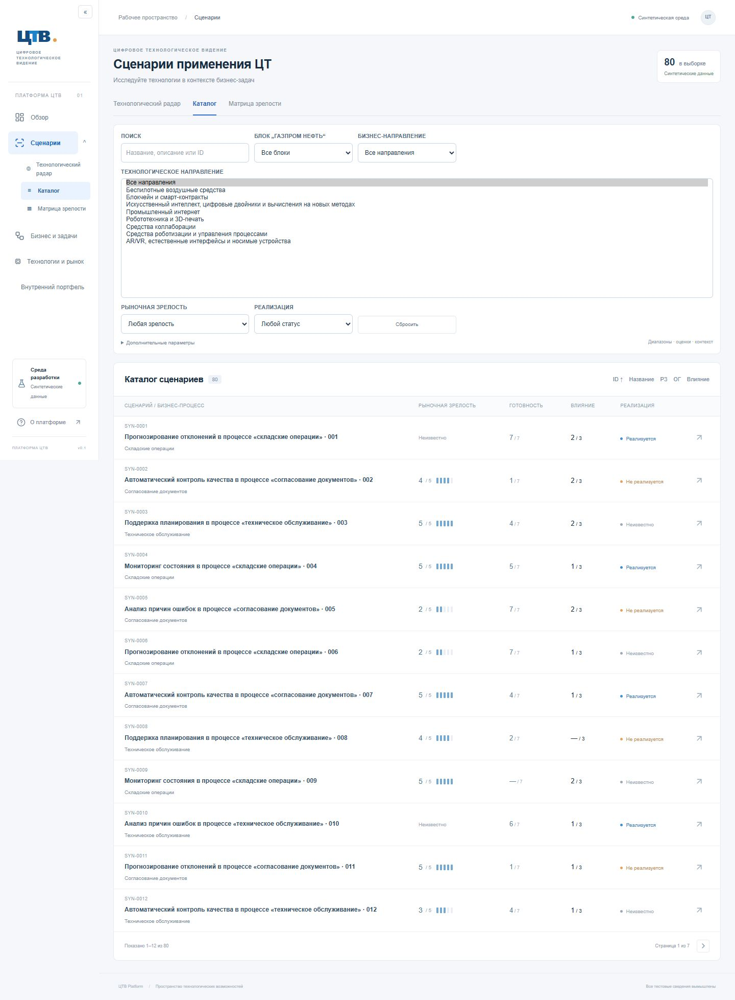
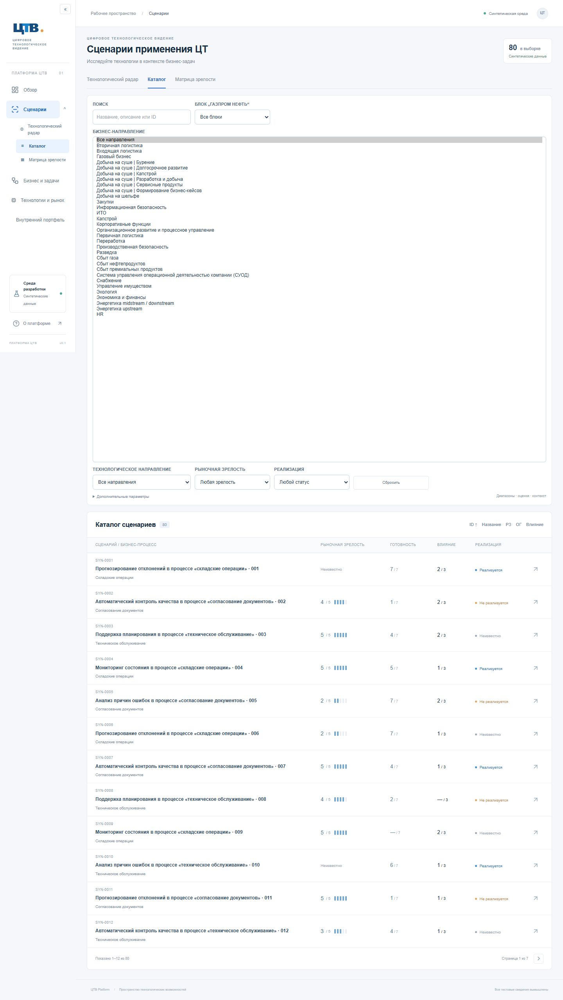
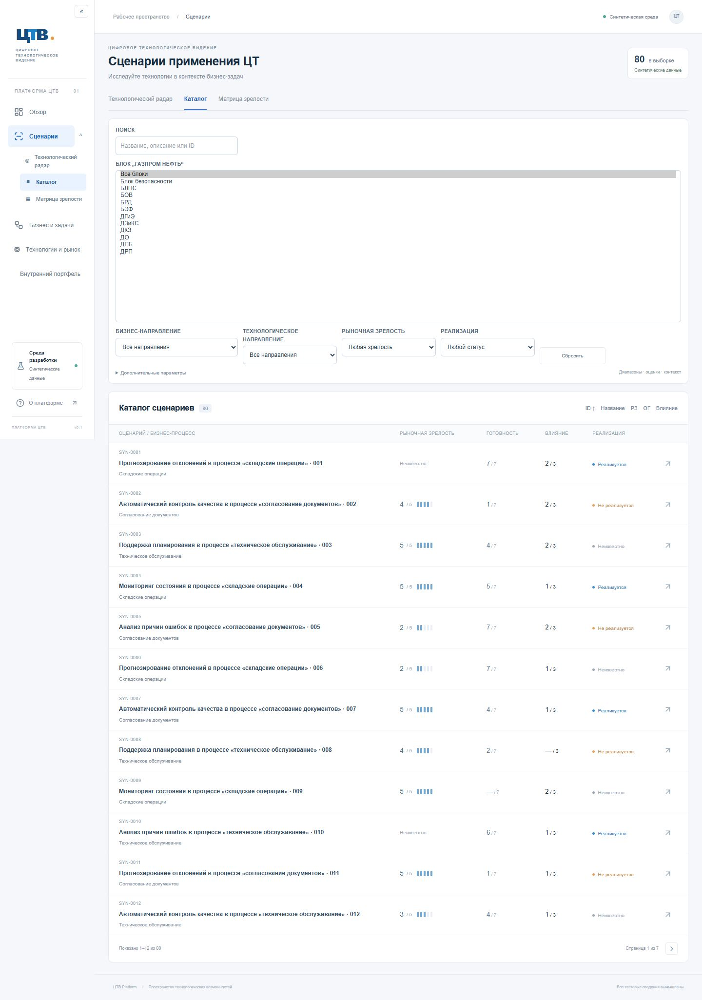

> Исторический отчёт. Полный справочник из сообщения пользователя реализован в [следующем обновлении](terminology-complete.md).

# Демонстрационная классификация ЦТВ — корректировка №2А.1

Это реализация классификации в работающей тестовой БД, а не импорт корпоративной базы. Предыдущая таблица `reference-mapping-2a1.md` была предварительной и не является итогом этой корректировки.

## Названия и источники

Из раскрытого технологического списка на странице 2 «ОтКсении27.10» перенесены буквально: «AR/VR, естественные интерфейсы и носимые устройства», «Искусственный интеллект, цифровые двойники и вычисления на новых методах», «Средства роботизации и управления процессами», «Средства коллаборации», «Блокчейн и смарт-контракты». Из подписей радара на странице 1: «Промышленный интернет», «Робототехника и 3D-печать», «БВС». Аббревиатура БВС не расшифровывается. Для ИИ выбран полный текст раскрытого списка, а не сокращённая секторная подпись.

Бизнес-направления: «Управление имуществом» — карточка на странице 2 того же PDF; «Переработка» — подтверждённый пример бизнес-ландшафта в материалах структуры ЦТВ. Это два подтверждённых элемента, не заявление о полноте справочника. Их связь со сценариями полностью искусственная.

Именованных блоков в предоставленных изображениях нет: видны только заголовок и «Все блоки». Поэтому таблица блоков создана, но не заполнена вымышленными наименованиями. Фильтр показывает «Все блоки». SQL-фильтрация блока, включая пересечение трёх условий, проверена временным синтетическим блоком исключительно в изолированной тестовой БД. В рабочую демонстрационную БД этот блок не загружается. Для наполнения этого списка нужны подтверждённые названия блоков; корпоративные ID не нужны.

## Что обновлено в БД

- Миграция `0002`: отдельные `organizational_blocks`, `business_directions`, `scenario_classification` с FK, происхождением и `is_synthetic`. Блоки не используются вместо функциональных групп или бизнес-процессов.
- Seed v2 добавляет 8 новых технологических направлений, 8 явно демонстрационных ключевых технологий, 8 демонстрационных методов, 2 бизнес-направления и источник происхождения. Старые 6 направлений и их технологии сохранены для исторических ссылок; основной список показывает v2 и несинтетические направления.
- В текущей локальной БД 80 сценариев получили 80 записей классификации с искусственным бизнес-направлением и неизвестным блоком (`null`); 100 прежних собственных синтетических технологических связей заменены на 80 связей с новой классификацией. Сценарии, их названия, процессы, функциональные группы и оценки не переименовываются.
- Внутренние ID стабильны, генерируются в пространстве `ctv-demo-classification-v2`. Записи справочников и связи отмечены синтетическими. Это не корпоративные идентификаторы и не утверждение о фактических применениях.
- Повторный seed идемпотентен. Переклассифицируются только синтетические сценарии собственного пространства `synthetic-v1-*`. Чужие/несинтетические записи и связи не удаляются; чужая классификация не перезаписывается. Миграция только добавляет таблицы.

## Интерфейс и проверки

Основная панель содержит «БЛОК „ГАЗПРОМ НЕФТЬ“», «БИЗНЕС-НАПРАВЛЕНИЕ», «ТЕХНОЛОГИЧЕСКОЕ НАПРАВЛЕНИЕ». Значения поступают через `/api/references` из PostgreSQL. Новые параметры `blockId`, `businessDirectionId` валидируются как UUID; SQL применяет их совместно с технологией и остальными условиями. Бизнес-процесс/этап остаётся отдельным дополнительным фильтром. Техническая надпись об учебном ландшафте удалена; глобальная синтетическая маркировка сохранена.

Проверки: `npm run check` (66 тестов, линтер, TypeScript, production build), `npm run test:postgres` (15), `npm run test:e2e` (18 на трёх размерах окна). Браузер проверяет значения БД, пересечение бизнеса и технологии, выбранный сценарий и сохранение параметров во всех трёх представлениях; SQL-тест дополнительно проверяет блок и защиту несинтетических записей. CI выполняет эти браузерные проверки с синтетической PostgreSQL-базой.

## Снимки списков

Нативные всплывающие окна select находятся вне снимка веб-страницы. Для воспроизводимых снимков тест временно раскрывает тот же элемент select как нативный listbox (`size`), без подмены названий, вариантов или API. В обычном интерфейсе это компактные выпадающие списки. Изображения содержат только демонстрационные данные; оригинальные изображения и PDF не публикуются.

Запуск обновления: `npm run db:migrate`, затем `npm run db:seed`, `npm run build`, `npm start`. №2Б не реализовывалось.
