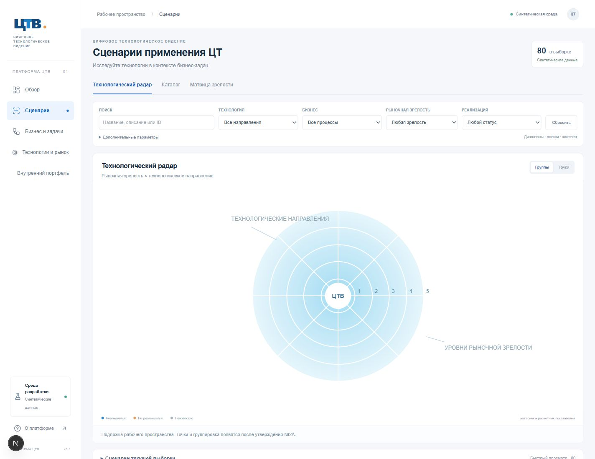
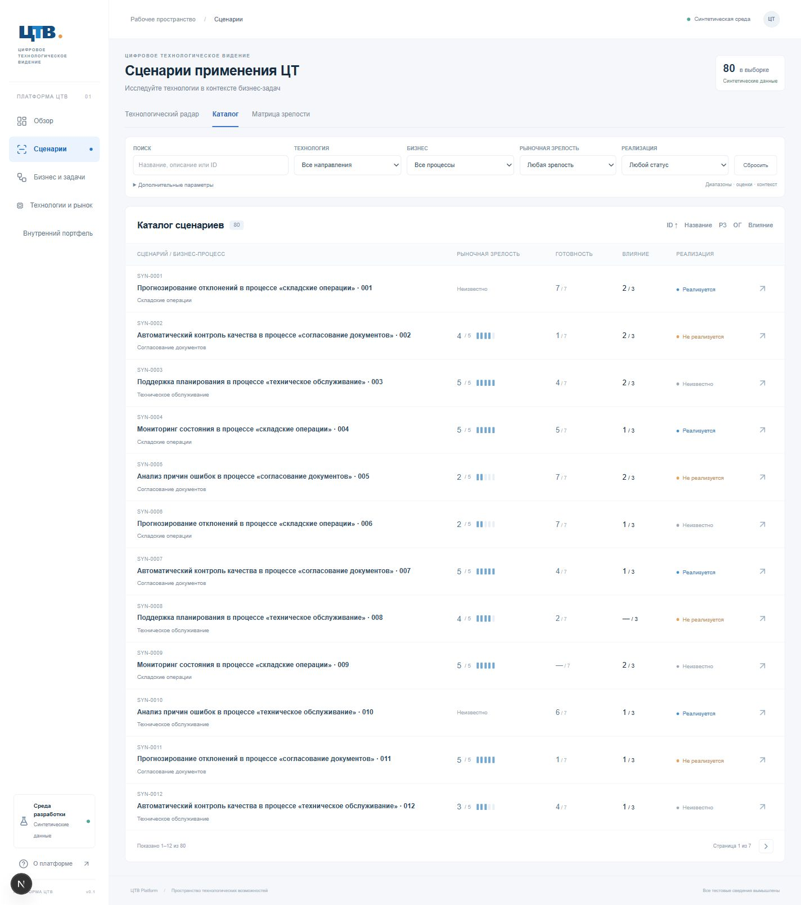
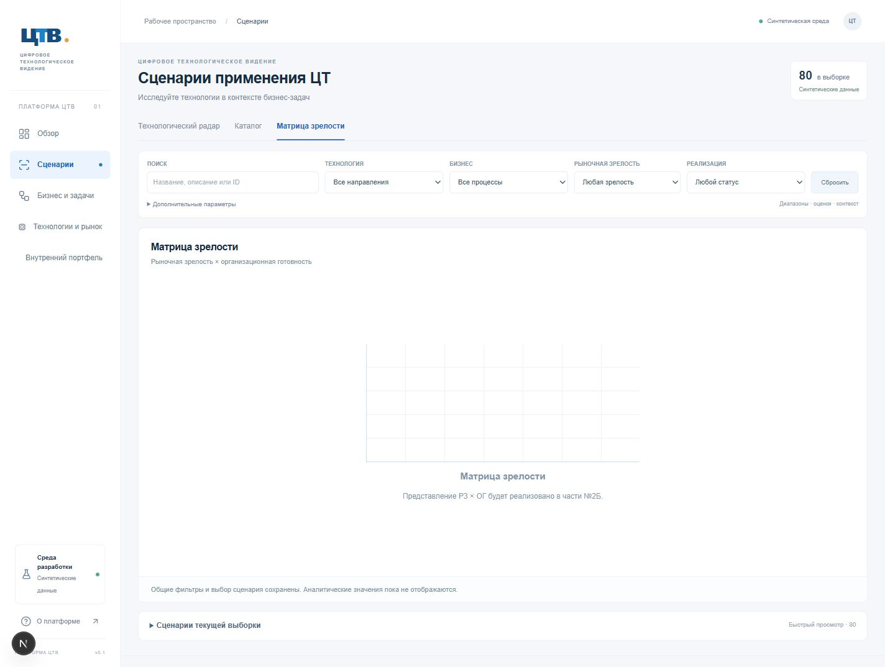
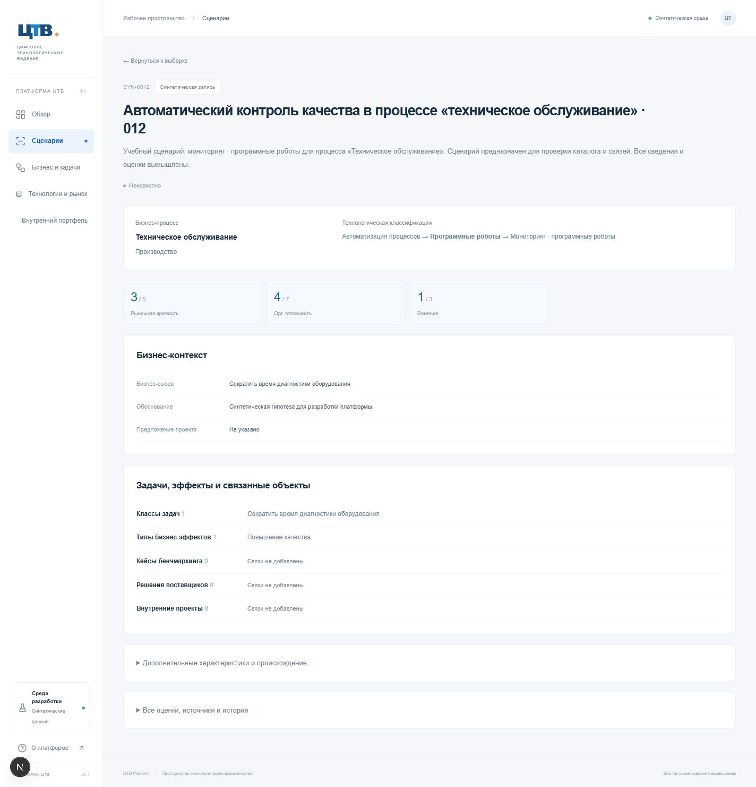
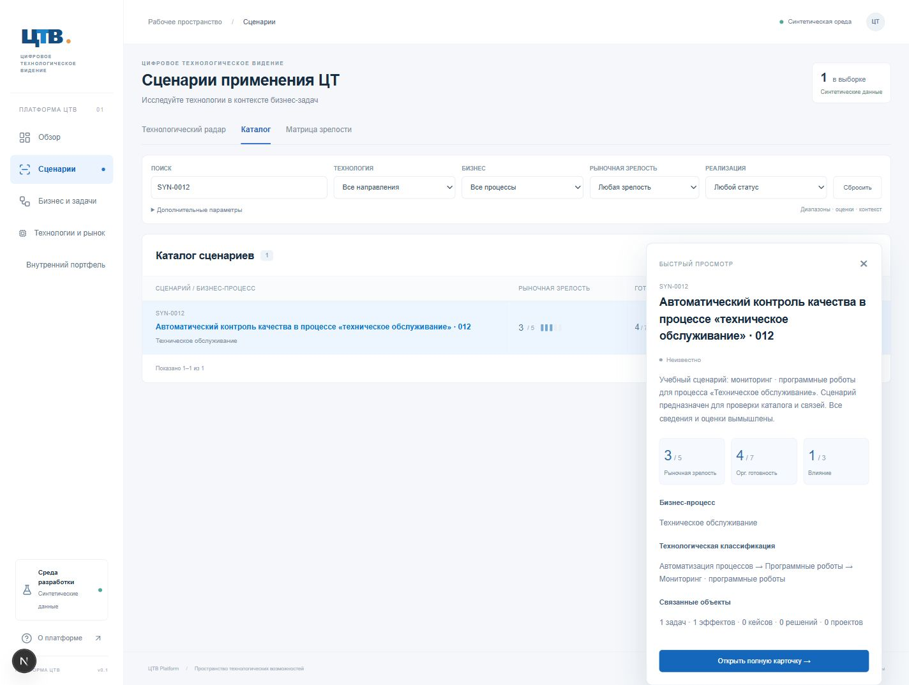

# ТЗ №2А — UX-архитектура раздела «Сценарии»

Реализована только часть №2А. Полное ТЗ №2 прочитано; интерактивный HTML-прототип A и его скриншот использованы как основной UX-ориентир, PDF исходного радара — как визуальный ориентир. Исходные корпоративные файлы не включены в Git. База — `codex/foundation` с обновлением CI `23d6276`; рабочая ветка — `codex/scenarios-ux-2a`.

## Что изменилось относительно первой итерации

- `/scenarios` перенаправляет на `/scenarios/radar`, сохраняя query parameters. Отдельные маршруты каталога и матрицы: `/scenarios/catalog`, `/scenarios/maturity`. Адреса карточек `/scenarios/[id]` сохранены.
- Общие заголовок, компактные вкладки и горизонтальная фильтрация находятся над одной рабочей областью. Таблица больше не расположена над радаром. Широкая аналитическая область видна сразу. Глобальная боковая навигация на широком экране сужена до 194 px.
- Поиск и селекторы применяются автоматически через App Router. Пять основных фильтров остаются в одной строке при 1440 px; дополнительные оценки, диапазоны и контекст скрыты под раскрываемым блоком. Сброс оставляет текущую вкладку, контекст организации и режим плотности; очищает фильтры, выбранный объект, сортировку и страницу.
- URL — единый источник состояния: фильтры, сортировка, страница, организационный контекст, `selected` и `mode`. Вкладки не создают независимых состояний. «Группы / Точки» пока только сохраняет выбранный режим для следующей части, без имитации визуализации.
- Название в каталоге открывает инспектор справа поверх рабочей области. Отдельная стрелка открывает полную карточку. Закрытие инспектора и Escape сохраняют выборку. Инспектор не резервирует постоянную колонку. Выбранный сценарий сохраняется при смене вкладок и может оставаться доступным за пределами текущей страницы/выборки.
- Карточка сначала показывает описание, бизнес-процесс, технологическую классификацию, статус и оценки текущего контекста. Бизнес-контекст и связанные сущности расположены ниже. Метаданные, дополнительные характеристики, все источники и история оценок сохранены в компактных раскрываемых блоках. Пустые связи показываются строками, без отдельных пустых карточек. Возврат ведёт в исходное представление с прежними параметрами и выбранным сценарием.
- Технические обозначения подключения убраны из заголовка таблицы. Синтетическое происхождение данных остаётся заметным и компактным.

## Файлы и компоненты

Новые: страницы трёх представлений, `Workspace`, `Inspector`, `Metrics`, типы представлений и URL-helper в `features/scenarios/navigation.ts`, тесты `scenario-navigation.test.ts`.

Обновлены: прежняя точка входа раздела, полная карточка, `ScenarioFilters`, `ScenarioCatalog`, стили, компактная глобальная оболочка, Zod-контракт параметров, SQL-сервис и HTTP smoke-проверка. Модель данных, миграции, генератор, импорт и существующие GET endpoints сохранены.

## Совместимость серверного контракта

Прежние параметры `maturity`, `readiness`, `impact` продолжают работать. Добавлены `maturityMin/Max`, `readinessMin/Max`, `impactMin/Max` с независимой проверкой диапазонов. При одновременной передаче точного значения и диапазона применяется пересечение; UI очищает точное значение при выборе соответствующего диапазона. Оценки отбираются только из текущего организационного контекста. Неизвестные оценки не подменяются значениями.

`sort=id|name|maturity|readiness|impact`, `order=asc|desc` выполняются на сервере. Неизвестные оценки при сортировке помещаются последними; UUID обеспечивает устойчивый порядок при равных значениях. Фильтр бизнес-направления включает дочерние процессы через рекурсивный SQL, а не массив в браузере. Пагинация и ограниченный размер ответа сохранены.

## Проверки

- `npm run check`: ESLint, TypeScript, 60 тестов и production build — успешно.
- `npm run test:postgres`: 13 интеграционных тестов — успешно на локальном PostgreSQL 17.10, в отдельной тестовой БД.
- `BASE_URL=http://127.0.0.1:3002 npm run test:http`: 23 проверки страниц и API — успешно, включая все три новых маршрута и прежние четыре раздела.
- Браузерный маршрут: автоматический поиск `SYN-0012` → каталог → инспектор → матрица с тем же выбранным ID → полная карточка → возврат в матрицу с прежней выборкой → Escape → сброс на текущей вкладке. Проверены также пагинация и восстановление ссылок фильтров.
- При ширинах 1440, 1920 и 768 px проверено отсутствие горизонтальной прокрутки всего документа; таблица на узком экране имеет собственную прокрутку.
- GitHub Actions использует существующий workflow `CI`: установка по lockfile, линтер, типы, тесты и сборка. Ссылка на запуск и его фактический результат приведены в итоговом сообщении после отправки коммита.

Скриншоты сделаны браузером с viewport 1440 × 1000; full-page снимки могут быть выше viewport. Экспорт браузера исключает полосу прокрутки, поэтому ширина JPEG содержимого составляет 1424 px при подтверждённом `innerWidth=1440`.

## Снимки

## Границы и следующий шаг

Полноценный радар, размещение точек, агрегирование групп, zoom/pan и рабочая матрица зрелости не разрабатывались. Радиальная подложка и контур матрицы явно обозначены как заготовки. Число секторов этой подложки не является моделью технологического справочника. Быстрый список использует ограниченную страницу PostgreSQL; никаких случайных маркеров и вымышленных аналитических значений нет.

Результат №2А передаётся на UX-проверку. Переход к №2Б — только после отдельного утверждения. Корпоративная авторизация, редактор данных и внешняя публикация приложения не добавлялись.
