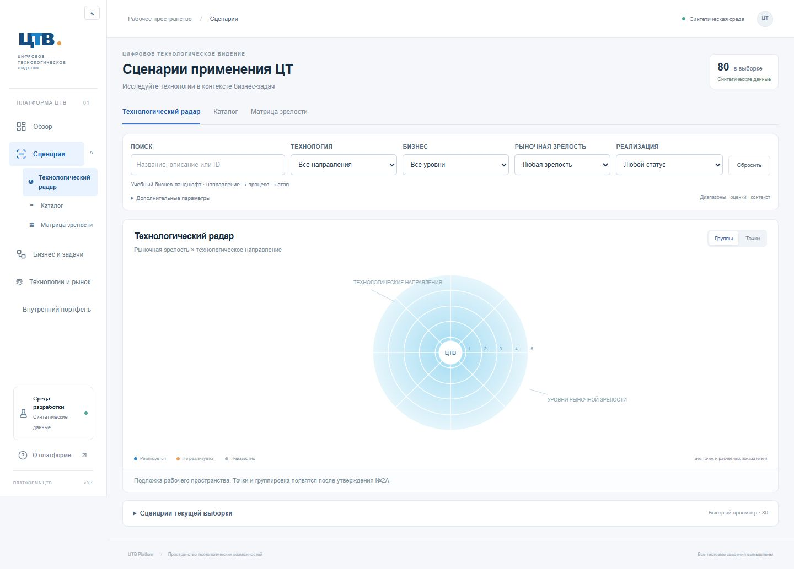
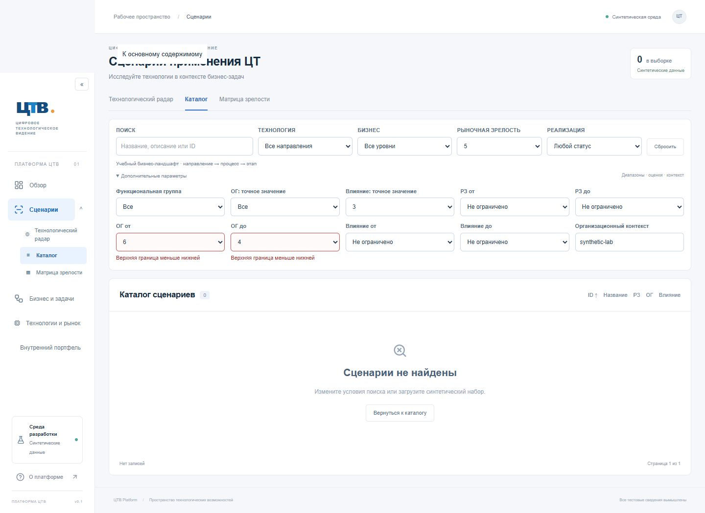
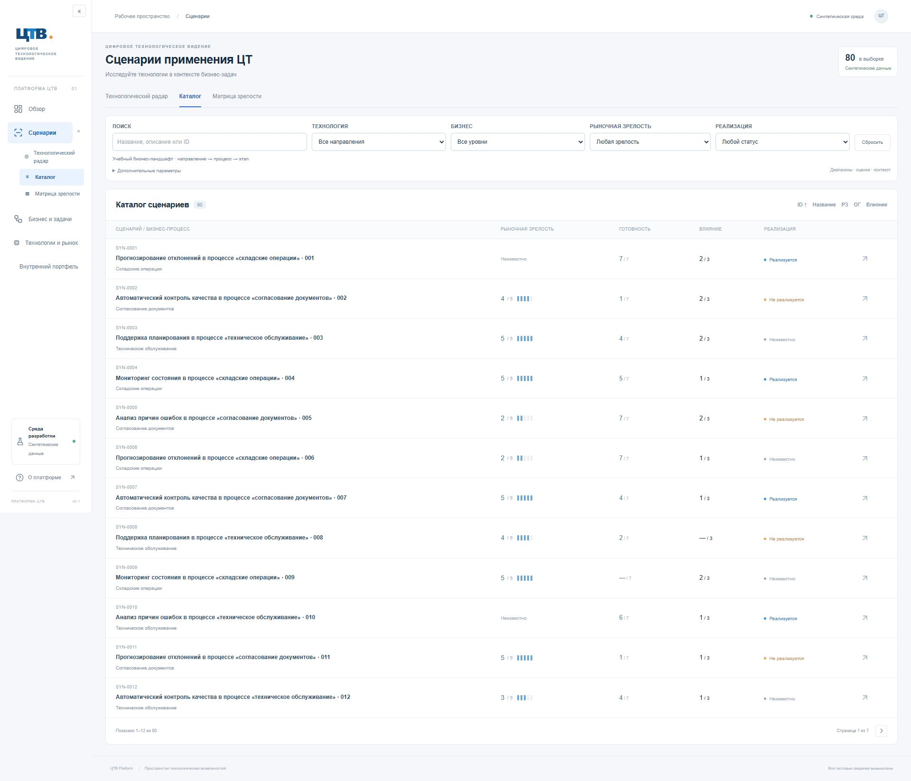
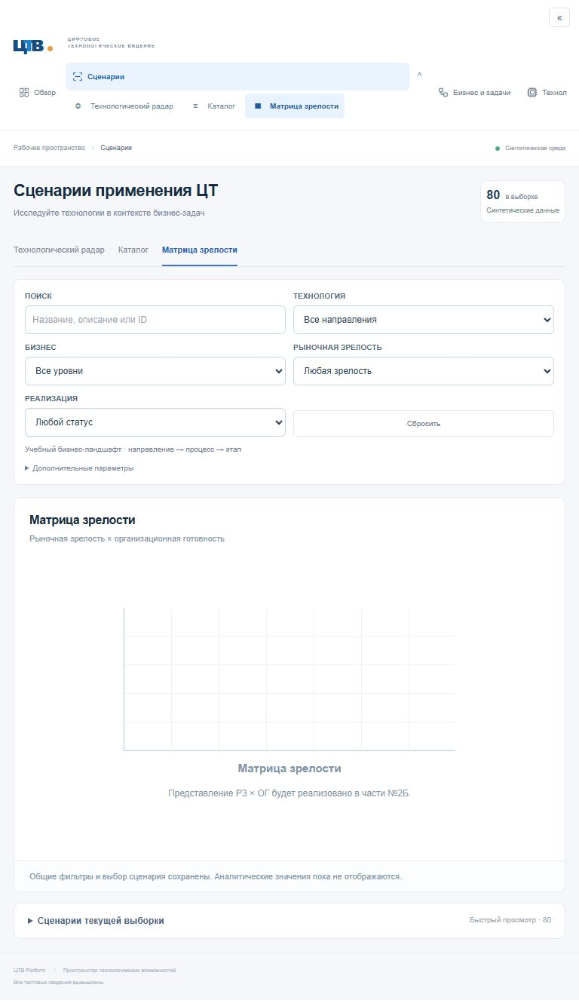

# №2А.1 — стабилизация UX перед №2Б

База: `550bf2ba5a91a111e17aaf713fec67bf58ec5d68`, ветка результата `codex/scenarios-ux-2a1`. Архитектура A, серверные API, схема, миграции и содержимое основной БД сохранены. №2Б и анимированный фон «Обзора» не реализовывались.

## Изменения

- «Группы / Точки» используют `replace` и `scroll={false}`. Сохраняются фильтры, контекст, выбранный ID и геометрия страницы. История не разрастается при смене режима.
- Сброс, сортировка, открытие/закрытие быстрого просмотра не вызывают автоматической прокрутки Next.js. Программный фокус использует `preventScroll`; Escape заменяет текущую запись истории.
- При открытии полной карточки сохраняются позиция и раскрытие быстрого списка/дополнительных фильтров в `sessionStorage`, по нормализованному внутреннему URL. Возврат восстанавливает их. Если хранилище браузера отключено, переходы остаются доступны, но восстановление позиции из карточки не гарантируется.
- Инспектор расположен ниже панели управления и не перекрывает переключатель плотности. Постоянная колонка справа не добавлена.
- РЗ, ОГ и влияние используют единое правило: выбор точного значения очищает обе границы; редактирование границы очищает точное значение. Конфликтный черновик остаётся в форме с сообщениями возле полей и не отправляется в API. Последняя корректная выборка остаётся на экране. Для ручных URL с противоречивыми границами рабочая оболочка сохраняется, конфликтные границы показываются у полей и не применяются к SQL. HTTP API продолжает строго отклонять некорректные диапазоны.
- Левая панель сворачивается. Переход в раздел и раскрытие подразделов — разные элементы. Прямые ссылки на три представления сохраняют текущую выборку и выбранный ID, активный подраздел отмечен, клавиатура поддерживается, в свёрнутом виде доступны подсказки и доступные имена.
- Увеличены шрифты и контраст фильтров; бизнес-узлы помечены как направление / процесс / этап, происхождение учебного ландшафта обозначено. Ссылка «Открыть каталог сценариев» теперь ведёт прямо на `/scenarios/catalog`.

Основные файлы: `filter-state.ts`, `filters.tsx`, `workspace.tsx`, `inspector.tsx`, `scroll-context.tsx`, `catalog.tsx`, `shell.tsx`, стили и ссылка «Обзора». Браузерные тесты: `tests/browser/stability.spec.ts`, конфигурация `playwright.config.ts`; доменные проверки: `tests/filter-state.test.ts`.

## Сверка справочников

[Таблица соответствий и недостающих сведений](reference-mapping-2a1.md) подготовлена до исправлений интерфейса. Учебные UUID не переименованы в корпоративные. Полный перечень блоков ГПН, бизнес-направлений, исходных ID и их связей не предоставлен: корпоративное обновление БД сознательно оставлено отдельному согласуемому этапу. Тематическое сходство названий не считается подтверждённым соответствием.

## Проверки и воспроизведение

- ESLint и TypeScript; 64 unit/интеграционных теста на PostgreSQL WASM; production build.
- 13 интеграционных тестов на отдельной настоящей PostgreSQL БД.
- 23 HTTP smoke-проверки маршрутов и API на локальной production-сборке.
- Браузерная регрессия: 15 сценариев (5 маршрутов × 3 размера окна): **1440 × 900**, **1920 × 1080**, **768 × 900**. Смена режима проверяется на реально прокрученной странице с закрытым и открытым инспектором, с проверкой неизменной высоты документа и допуска 2 px. В локальном прогоне все шесть измерений смены режима: **120 → 120 px, отклонение 0 px**. Также проверяются история, Escape, карточка/возврат, сброс, сортировка, «ОГ до 4 → ОГ = 7», конфликты и прямые ссылки боковой панели. Высота таблицы при сортировке может меняться из-за переноса названий; для неё проверяется сохранение позиции, а не тождественность высоты строк.
- GitHub Actions дополнен браузерной регрессией: PostgreSQL 17 с синтетической БД, миграции/seed, Chromium и `npm run test:e2e`. Итоговый статус запуска для отправленного коммита указан в сообщении сдачи со ссылкой на CI.

Локально: `npm run check`, `npm run test:postgres`, `npm run test:e2e`. Для e2e требуется доступная синтетическая БД из `.env`; конфигурация запускает production-сборку на `127.0.0.1:3002`. Windows использует установленный Chrome, Linux CI — Chromium (`npx playwright install --with-deps chromium`). Сервер на этом порту должен относиться к проверяемой сборке; иначе остановить его перед проверкой. `SAVE_UX_SCREENSHOTS=1` сохраняет снимки в `docs/screenshots/2a1/`. Трассы неудачных прогонов остаются в игнорируемой `test-results/`.

## Скриншоты

Снимки получены автоматически из синтетической БД, после завершения загрузки рабочей области. Приведены три размера окна; исходные корпоративные изображения не копировались.

