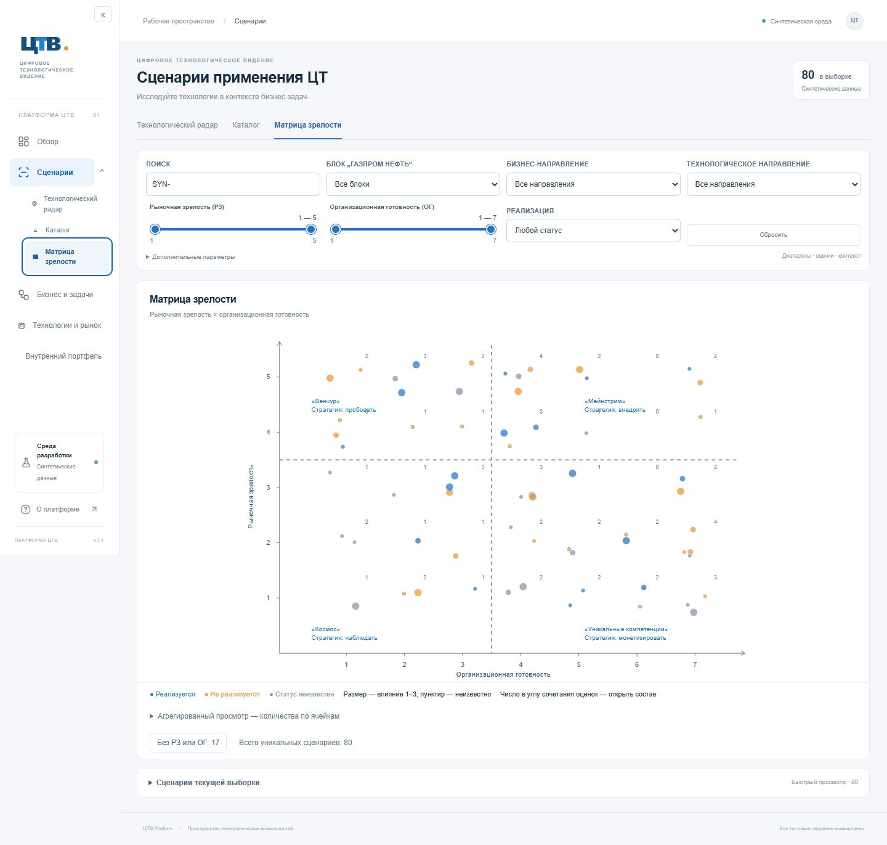

# Корректировка №2Б перед визуальной приёмкой

Ветка `codex/scenarios-2b`, база `a0a10d6`. Схема, миграции, серверные запросы аналитики, синтетические справочники и страница «Обзор» не изменяются.

## Фактическая причина аварии

Ошибка воспроизведена в Chrome на исходной production-сборке: открытие радара с `zoom=8&panX=4000&panY=4000`, затем 12 быстрых перетаскиваний. Консоль показала `TypeError: Cannot read properties of null (reading 'px')` в клиентском чанке радара; после этого появился общий экран «Данные временно недоступны». В серверном журнале за воспроизведение ошибок PostgreSQL не было. Отдельный 404 favicon не является причиной аварии.

В старом `onPointerMove` функция обновления состояния читала изменяемый `drag.current!.px`. React мог выполнить её после `onPointerUp`, уже обнулившего `drag.current`. Теперь начало жеста копируется в локальную константу до расчёта следующей позиции; обработчик не читает изменяемую ссылку внутри отложенного updater. Аварийный экран также исправлен: он больше не объявляет PostgreSQL предполагаемой причиной любой ошибки UI.

## Камера, viewport и подписи

Камера вынесена в `use-radar-camera.ts`, геометрия — в `domain/camera.ts`. `ResizeObserver` измеряет настоящую рабочую область. SVG viewBox соответствует её ширине и высоте, внутренний clip 680×580 удалён. Прежние мировые координаты маркеров сохранены как координаты данных, но больше не образуют самостоятельного viewport. Обрезка происходит только по внешней границе рабочей области. Управление, контекстные подписи и инспектор находятся над графическим слоем.

Ограничение pan зависит от текущего масштаба и размеров viewport: радар всегда содержит центральный диск радиусом 28% короткой стороны рабочей области. Поэтому существенная часть круга остаётся видимой даже при максимальном диагональном перемещении. Координаты NaN/Infinity нормализуются, масштаб ограничен 1–8. Загруженные из старого URL чрезмерные координаты также геометрически ограничиваются.

Изменение камеры использует `history.replaceState`, штатно интегрированный с Next App Router. Камера не вызывает `router.replace`, SQL или повторную передачу аналитической выборки. Prefetch у ссылок с меняющимися координатами отключён. `ContextLink`, фильтры и действия инспектора подхватывают текущую камеру из URL: переходы, выбранный сценарий и возврат из карточки сохраняют её. Камера меняется без увеличения истории и сброса прокрутки. Обработка Escape для трёх рабочих представлений закреплена в постоянно смонтированной оболочке: обработка закрытия не зависит от повторного подключения самого инспектора. Браузерный тест возврата теперь проверяет адрес радара и наличие инспектора перед Escape, а не только параметр `selected`, присутствующий также в адресе полной карточки. Для остальных разделов поведение не меняется.

Подписи находятся в отдельном HTML-слое, без масштабирования. При открытом инспекторе toolbar остаётся свободным: инспектор расположен ниже него, а рейки подписей используют оставшееся место (на узком экране объединяются слева). Видимые направления определяются выборкой точек viewport с проверкой попадания в круг и сектор. Боковые рейки сортируются по вертикальному положению соответствующих секторов; текст не пересекается с управлением или соседними подписями, полное название доступно через `title`. Выборка для видимости дискретная: очень тонкий фрагмент сектора на самом краю может не получить отдельную подпись, но ближайшие направления видимой части остаются подписаны.

## Основная матрица — точечная

`matrix-scatter.tsx` показывает один маркер на сценарий с известными РЗ и ОГ. X — ОГ 1–7, Y — РЗ 1–5. Стабильное смещение по UUID остаётся внутри сочетания оценок; округление координат возвращает фактические оценки. Цвет, размер и обозначение неизвестного влияния соответствуют радару. Доступны выбор мышью/клавиатурой, инспектор, полная карточка и открытие состава плотного скопления через маленький счётчик в углу сочетания оценок. Без РЗ/ОГ сценарии по-прежнему доступны отдельным списком.

По приложенному оригиналу матрицы сверены и восстановлены: стрелки осей, деления, разделители между уровнями 3 и 4 по обеим шкалам (3.5), четыре подписи и стратегии: «Венчур» / пробовать, «Мейнстрим» / внедрять, «Космос» / наблюдать, «Уникальные компетенции» / монетизировать. Это визуальные элементы подтверждённого оригинала, а не новые формулы оценок или автоматическая рекомендация по отдельному сценарию. Тепловая таблица сохранена второстепенно в закрытом блоке «Агрегированный просмотр».

## Проверки

- `npm run check`: ESLint, TypeScript, 74 теста, production build.
- `npm run test:postgres`: 17 интеграционных тестов; отдельная `_test` база, набор расширяется до 2500.
- `npm run test:e2e`: 27 браузерных проверок на 80 сценариях, размеры 1440×900, 1920×1080, 768×900.
- `node scripts/verify-large.mjs`: 9 браузерных проверок на 2500 в отдельной базе/порту, включая новый `viewport.spec.ts`. Тот же набор добавлен в CI.

Новая регрессия выполняет по четыре последовательных перетаскивания к каждой из четырёх сторон и двум диагоналям при каждом масштабе 1×, 3× и 8×. Проверяет геометрический инвариант видимости, соответствие viewBox фактическому viewport, отсутствие клиентских ошибок и аварийного экрана, наличие читаемых подписей и отсутствие их взаимных пересечений/пересечений с управлением. Отдельно считает сетевые запросы: при изменениях камеры ожидается **0** RSC-запросов или запросов к аналитическому API. Проверяет сохранение фильтра/выбора и соответствие матричных координат данным РЗ/ОГ.

Новые изображения получены из приложения с синтетическими данными. Перед снимком только сбрасываются прокрутка документа и видимый фокус; камера и данные остаются в проверяемом состоянии. Исходные корпоративные изображения не копировались в Git.

## Снимки для сравнения

| Состояние                  | 1440 px                                                  | 1920 px                                                  |
| -------------------------- | -------------------------------------------------------- | -------------------------------------------------------- |
| Полный радар               | [Снимок](screenshots/2b-correction/radar-1440.jpg)       | [Снимок](screenshots/2b-correction/radar-1920.jpg)       |
| Радар 3×                   | [Снимок](screenshots/2b-correction/radar-3x-1440.jpg)    | [Снимок](screenshots/2b-correction/radar-3x-1920.jpg)    |
| Предельное смещение при 3× | [Снимок](screenshots/2b-correction/radar-limit-1440.jpg) | [Снимок](screenshots/2b-correction/radar-limit-1920.jpg) |
| Основная точечная матрица  | [Снимок](screenshots/2b-correction/matrix-1440.jpg)      | [Снимок](screenshots/2b-correction/matrix-1920.jpg)      |

Остающиеся ограничения: у 2500 точек возможны перекрытия, для них доступны масштабирование/группы радара и состав сочетания оценок матрицы; подписи используют дискретную оценку видимости секторов. Другие продуктовые модули и корпоративная модель данных не перерабатывались. После сдачи — остановка для визуальной приёмки.
