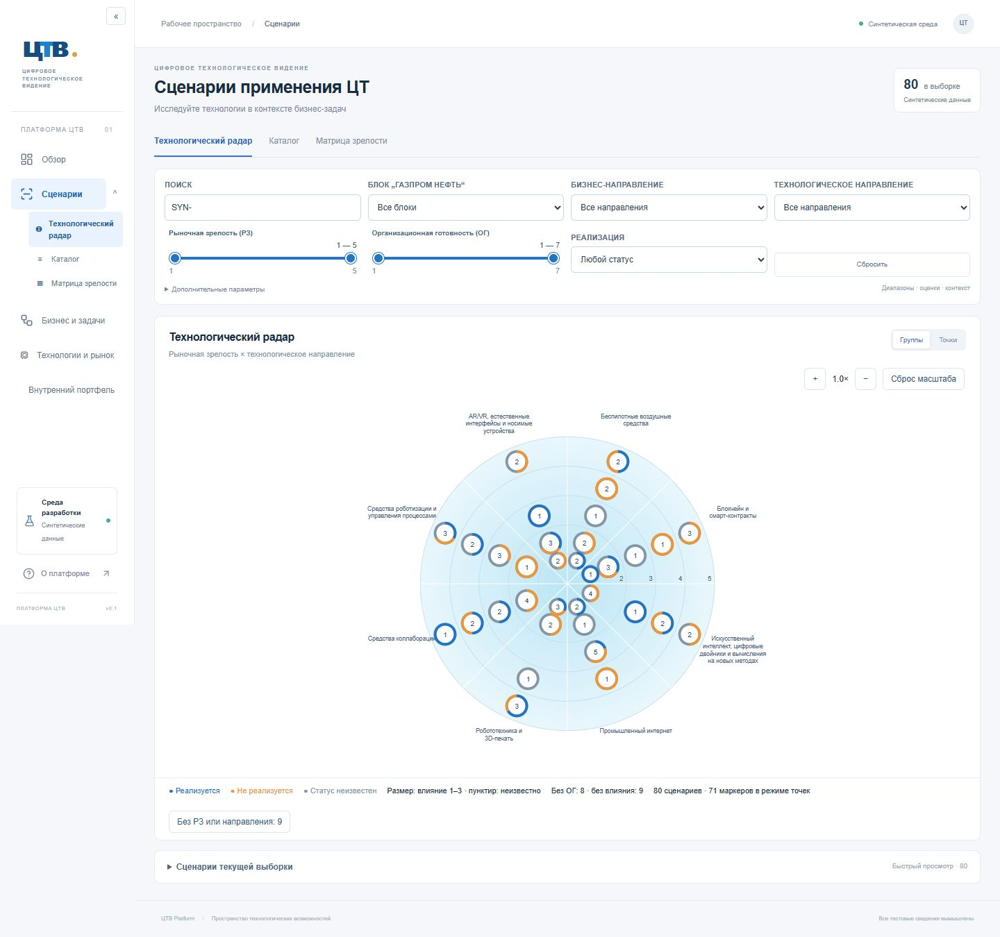
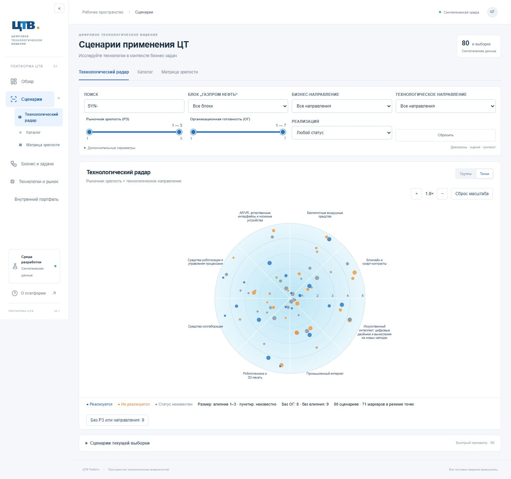
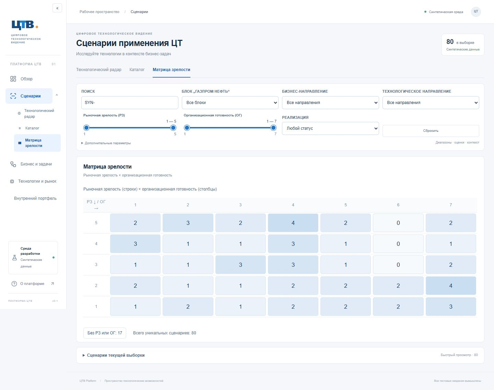

# №2Б — интерактивная аналитика сценариев

База: `245d7cf`, ветка `codex/scenarios-2b`. Схема БД и существующие миграции сохранены. Никакие корпоративные записи не загружались. Основная локальная база остаётся на 80 синтетических сценариях; проверка 2500 выполняется на отдельной `_test` БД.

## Реализация

- `src/server/analytics.ts`, `/api/scenarios/analytics`: компактная выборка всех подходящих сценариев с текущими оценками выбранного организационного контекста и различными технологическими направлениями. Не зависит от `page/pageSize`; подробные карточки всей выборки не загружаются. Использует те же SQL-условия, что каталог, в согласованном снимке PostgreSQL.
- `src/domain/analytics.ts`: правила группировки, матрицы, устойчивых координат, размеров и цветов. `analytics-view.tsx`: SVG-радар с zoom относительно курсора, pan через Pointer Events, кнопками масштаба/сбросом, клавиатурным выбором, подсказками, составом групп, инспектором и матрицей. Маркеры мемоизированы на время жестов камеры. SVG выбран ради доступных фокусируемых элементов и сопровождаемости на целевых 2500 сценариях.
- `range-filter.tsx`, `filters.tsx`: две нативные range-шкалы с общим треком и двумя независимыми ручками, числовыми границами, целыми шагами и ограничением пересечения. Поддерживают клавиатуру и нативные pointer/touch-жесты. Изменение применяется при отпускании ручки, завершении клавиши или потере фокуса, чтобы не отправлять SQL-запрос на каждый пиксель движения.
- Параметры диапазонов и камеры, группы/ячейки, контекст и выбранный ID сохраняются в URL. Полная карточка использует существующее восстановление позиции/раскрытия списков. Старые точные `maturity/readiness` остаются в API; UI отображает их как совпадающие границы и при изменении удаляет точное значение. Полный диапазон 1–5 / 1–7 не отправляет числового ограничения и включает неизвестные значения.
- «Бизнес-процесс / этап» отключён, содержательных вариантов нет. Существующая модель и обратная совместимость API сохранены. Три восстановленных классификатора работают как прежде.

## Визуальное кодирование

Сектора строятся из технологического справочника, без фиксированного числа. РЗ задаёт кольцо 1–5 от центра наружу. Стабильное смещение точки зависит от UUID и остаётся строго внутри правильного кольца/сектора; оценка не меняется. Для разных направлений одного сценария показывается по маркеру, для нескольких методов одного направления — один маркер. Общий счётчик и матрица считают уникальные сценарии. Выбор ID выделяет все его точки; в режиме групп выделяются содержащие его группы.

Точки: синий — реализуется, оранжевый — не реализуется, серый — статус неизвестен. Радиус для влияния 1/2/3: 3.5/5/6.5 SVG-единиц. Неизвестное влияние имеет отдельный радиус 3 и пунктирную обводку. Группы объединены по направлению и РЗ, число в центре — количество уникальных сценариев, сегменты обводки — доли статусов; размер группы служит читаемости счётчика, а не оценке влияния. В первом кольце размер ограничен угловым расстоянием, чтобы соседние группы не перекрывались.

Без РЗ или технологической связи сценарий доступен через отдельный список «Без РЗ или направления». Без РЗ/ОГ в матрице — отдельный список, без назначения фиктивных координат. Неизвестные ОГ и влияние также посчитаны в легенде радара. Матрица показывает все 35 сочетаний РЗ × ОГ, без методологических квадрантов и придуманных границ.

## Проверки

`npm run check`: линтер, TypeScript, 72 автоматических теста и production build. `npm run test:postgres`: 17 тестов на настоящем PostgreSQL, включая полную аналитику 2500 сценариев, диапазоны, неизвестный контекст и множественные технологические связи. Старые проверки сохранены; браузерный тест выпадающих РЗ/ОГ адаптирован к замене этих контролов слайдерами, проверка влияния и ошибочных старых URL сохранена.

Браузер: `npm run test:e2e` — 24 проверки для 80 сценариев; `node scripts/verify-large.mjs` — 6 проверок для 2500 в отдельных размерах 1440×900, 1920×1080, 768×900. Последняя команда требует предварительного `npm run test:postgres`; она использует только `TEST_DATABASE_URL` и отдельный порт 3003. Папки результатов разделены. В CI после обычного прогона seed расширяется до 2500 и повторяется аналитический маршрут. Статус конкретного CI указан в сообщении сдачи.

Проверяются группы/точки, zoom колесом/кнопками, pan, сброс, инспектор, карточка/возврат, диапазоны, старые URL, отсутствие пересечения ручек, неизвестные значения, общие фильтры и сохранение параметров. Существующие проверки прокрутки и навигации также сохранены.

## Измерения и практические ограничения

Среда: Windows, локальные Node.js и PostgreSQL 17, установленный Chrome, production build. 10 последовательных серверных запросов по 2500 сценариям: медиана **171 мс**, максимум **492 мс**, JSON около **1 007 795 байт**. Скрипт: `node --conditions=react-server --import tsx scripts/benchmark-analytics.ts`. RSS Node в этом процессе — около 251 МБ (это весь процесс, не размер ответа).

В браузере для 80 сценариев — 71 координатный маркер и 9 записей без РЗ; для 2500 — 2222 и 278 соответственно. JS heap на этапе точечного отображения 2500: примерно 30–39 МБ. Маршрут с несколькими переходами и жестами занял около 4.7–5.5 с в прогретых браузерных проектах и 24.7 с в первом прогоне одновременно с другим набором браузерных тестов. Это длительность всего автоматизированного маршрута, не задержка одного действия; измерение не является production-бенчмарком или гарантией FPS.

При 2500 точек остаются перекрытия: рекомендуется режим групп, увеличение и выбор из состава группы; клавиатурный выбор также доступен. Список состава группы прокручивается. Нативные SVG-подсказки простые, отдельная методология квадрантов и автоматических выводов не добавлялась. Мультитач-pinch не реализован: на сенсорном устройстве доступны pan и кнопки масштаба. Реальная корпоративная авторизация, 3D, фон «Обзора», редактор и перспективные представления остаются вне итерации.

## Снимки

Запуск: `npm run db:migrate`, `npm run db:seed`, `npm run build`, `npm start -- --port 3002`, затем `/scenarios/radar`. После сдачи работа останавливается для приёмки.
