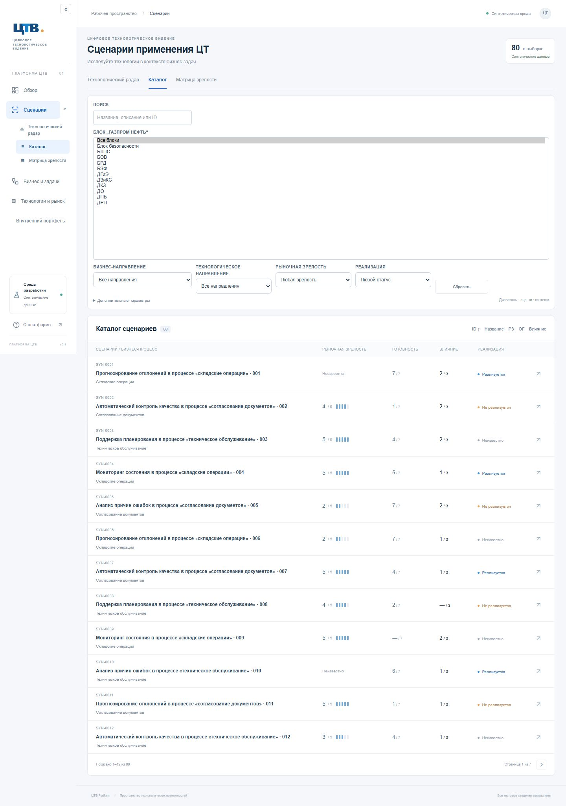
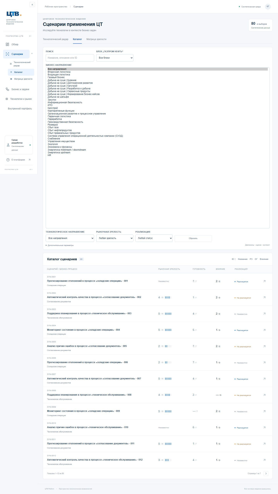
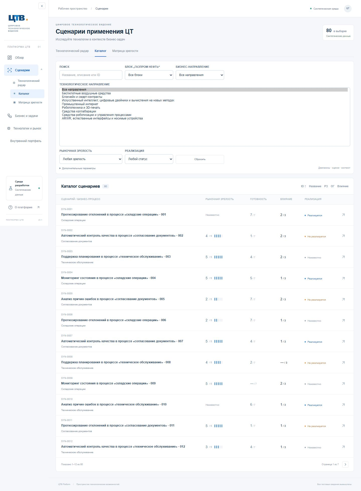

# Полный справочник терминологии ЦТВ

Ниже сохранена историческая запись версии 3. Актуальная терминология ФГ,
миграция и поведение seed описаны в [сверке содержания](scenario-methodology.md).

Источник названий — полный перечень, непосредственно предоставленный пользователем. Перечень хранится в `src/domain/terminology.ts` (11 блоков, 31 бизнес-направление), технологические направления — в `src/server/demo-classification.ts` (8). Все названия перенесены буквально: аббревиатуры не расшифровываются, разделители `|` сохранены. «БВС» уточнено до «Беспилотные воздушные средства».

Этот результат заменяет ограничения предварительных отчётов `reference-mapping-2a1.md` и `classification-correction.md`: справочник блоков теперь заполнен, бизнес-направления представлены полностью.

## Обновление БД

Команда `npm run db:seed` применяет демонстрационную классификацию версии 3 к существующим таблицам; новая миграция не требуется. На локальной базе: 11 блоков, 31 бизнес-направление, 8 активных демонстрационных технологических направлений, 80 записей классификации сценариев, 80 синтетических технологических связей. Каждый элемент справочника имеет хотя бы один связанный сценарий в наборе из 80 записей. Не каждая произвольная комбинация трёх фильтров обязана иметь результат.

Сохранены ID двух ранее добавленных бизнес-направлений и восьми технологических направлений. Для остальных созданы стабильные внутренние UUID. Новые блоки и бизнес-направления вставляются без перезаписи существующих записей. Уточнение технологического названия и обновление источника ограничены собственными синтетическими записями. Переназначаются только собственные синтетические связи сценариев; чужая и несинтетическая классификация сохраняется. Оценки, названия сценариев и бизнес-процессы не меняются. Повторный запуск seed не создаёт дубликатов.

Блоки, бизнес-направления, функциональные группы и процессы остаются разными сущностями. Названия справочника подтверждены пользователем, но UUID и связи сценариев вымышлены. Это не данные о фактических назначениях в компании.

## Интерфейс и проверки

Три основных фильтра получают все значения из PostgreSQL через `/api/references`; сервер применяет их совместно. Выбранные параметры и сценарий сохраняются между каталогом, радаром и матрицей. В инспекторе и полной карточке отображаются блок, бизнес-направление и отметка о синтетических связях.

Проверки: линтер, TypeScript, production build, 67 автоматических тестов, 16 интеграционных тестов на PostgreSQL, 18 браузерных тестов в окнах 1440×900, 1920×1080 и 768×900. Добавлена проверка того, что каждый из 50 элементов трёх справочников участвует в фильтрации. Браузер проверяет совместное применение трёх фильтров и сохранение всех параметров при переходах. Результат CI указан в сообщении сдачи.

## Снимки списков

Для воспроизводимого снимка нативный select временно отображается тестом как listbox (`size`): названия и варианты остаются теми же, полученными из БД. В обычном интерфейсе это выпадающие списки. Снимки содержат исключительно тестовые сценарии.

Локальное обновление: `npm run db:migrate`, `npm run db:seed`, `npm run build`, `npm start`. №2Б не реализовывается.
